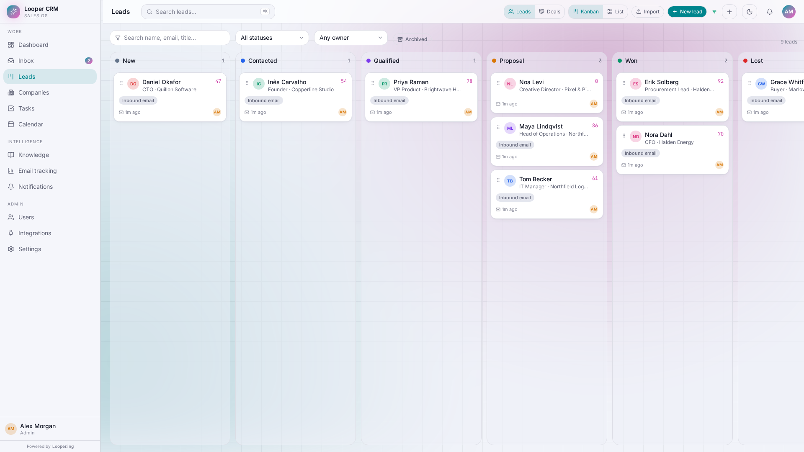
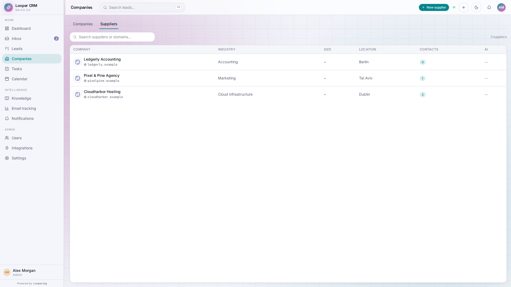
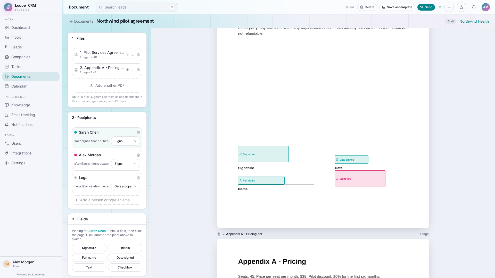
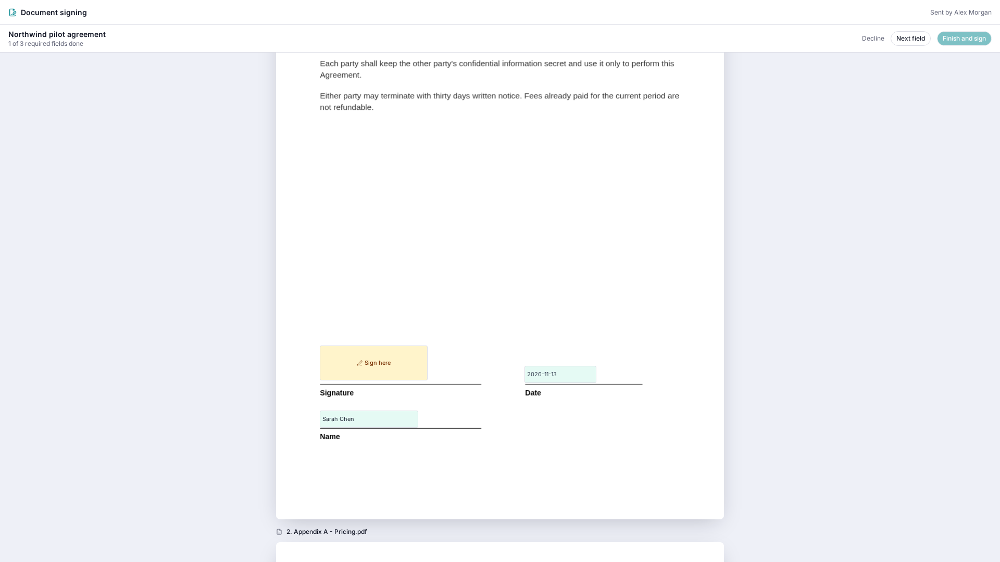

# Looper CRM

AI-assisted, local-first CRM: leads, companies and deals, a Gmail inbox with AI-suggested replies grounded in your own documents, Google Calendar scheduling, email tracking and document signing.

## Why this exists
I wanted to see whether I could ramp up a working CRM within a few hours. Up to now it has taken less than 8 hours of my time — from an empty folder to what you see below.

Built with [Looper](https://looper.ing), an AI-powered IDE for working on real codebases.

## Screenshots
Taken from a local instance filled with fictional demo data.

| | |
|---|---|
| **Dashboard** — pipeline, mail awaiting a reply, hottest leads<br> | **Inbox** — threads, conversation, AI suggested reply<br> |
| **Leads** — Kanban by pipeline stage<br> | **Deals** — one row per deal with contact, amount and close date<br> |
| **Companies**<br> | **Suppliers** — the second tab of the Companies page<br> |
| **Company page** — deal, leads, tasks, AI insights, threads<br> | **Tasks**<br> |
| **Document signing** — upload PDFs, add recipients, place fields<br> | **Signer's page** — opened from a private link, no account needed<br> |

## Quick start
Requires Node 22.
```bash
# backend
cd backend && cp .env.example .env && npm install && npm run dev      # http://localhost:3101
# frontend (proxies /api, /ws, /t to the backend)
cd frontend && npm install && npm run dev                              # http://localhost:5173
```
The first run creates an admin: `admin@looper.local` / `admin1234` (override with `SEED_ADMIN_EMAIL` / `SEED_ADMIN_PASSWORD`). Change the password in Settings → Password.

## Main features
- **Leads, companies and deals** — Kanban and list views with your own pipeline stages. Every company has a deal with an amount, owner and expected close date; a company can be split into several deals. Import leads from CSV or Excel.
- **Suppliers** — mark a company as a supplier to keep it, and its contacts, out of the sales pipeline.
- **Gmail inbox** — read and answer mail inside the CRM, with HTML mail, inline images and attachments. Threads link to companies, archiving syncs both ways with Gmail, and each user's mail is private to them.
- **AI-suggested replies** — drafts grounded in the documents and web pages you add to Knowledge, with the sources they used.
- **AI enrichment** — fills in company and lead details such as industry, size and a short summary.
- **Calendar scheduling** — connect Google Calendar, share a scheduling link, and let the AI propose meeting slots.
- **Email tracking** — see when a sent email was opened, clicked or bounced.
- **Tasks** — create a task from an email with an AI-suggested title and summary, linked to the thread, lead and company.
- **Document signing** — send one or more PDFs for signature. Place signature, initials, name, date, text and checkbox fields per signer; set a signing order, reminders and an expiry date. Signers open a private link, and everyone gets one signed PDF with a certificate page (who signed, when, and file fingerprints). This is a simple electronic signature with an audit trail, not a certificate-based digital signature.
- **Dashboard** — pipeline totals, win rate, mail awaiting a reply and the hottest leads.
- **Also** — live updates without refreshing, dark and light themes, and Hebrew/English text direction handled per message.

## Setup (admin)
1. **Admin → Integrations → Google Workspace OAuth**: create an OAuth web client in Google Cloud (enable the Gmail and Calendar APIs), paste the client id and secret, and use the redirect URI shown on the page.
2. **Admin → Integrations → AI providers**: add an Anthropic API key (used for reply drafts and enrichment).
3. **Knowledge**: upload PDF, DOCX, MD or TXT files, or scan your website. Replies cite this content.
4. Each user: **Settings → Email & calendar → Connect Google account**, then set a scheduling link and working hours in Profile.

## Tech stack
- **Frontend**: React 19, Vite, TypeScript, Tailwind v4.
- **Backend**: Node 22, Express, Socket.IO, SQLite.
- More detail on the product: [docs/prd.md](docs/prd.md).

## Before you put it online
Set your own long random values for `JWT_SECRET`, `JWT_REFRESH_SECRET` and `ENCRYPTION_KEY`, and your own `SEED_ADMIN_PASSWORD`, in `backend/.env`. The backend prints a `SECURITY WARNING` at startup while any of them is still a default.

## License
MIT — see [LICENSE](LICENSE).
