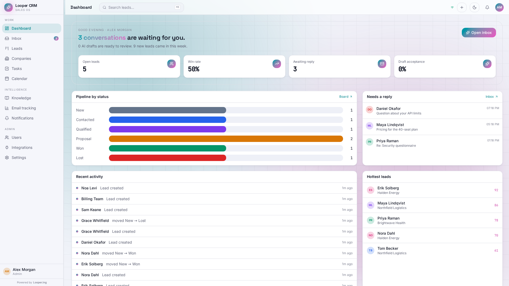
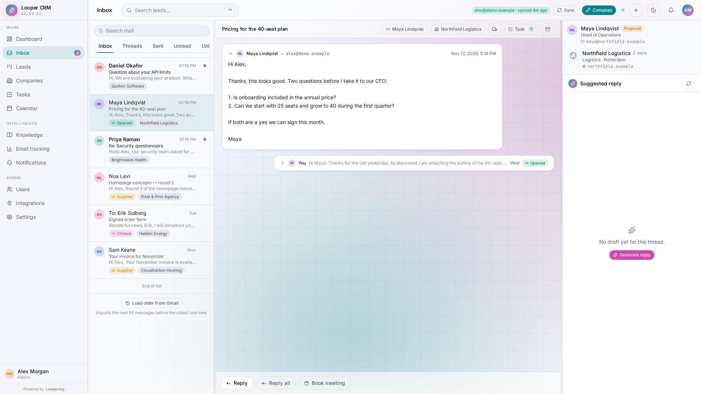
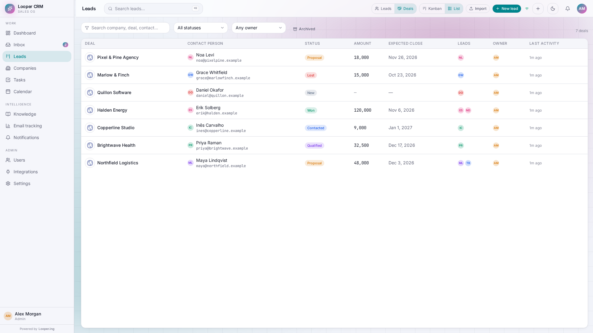
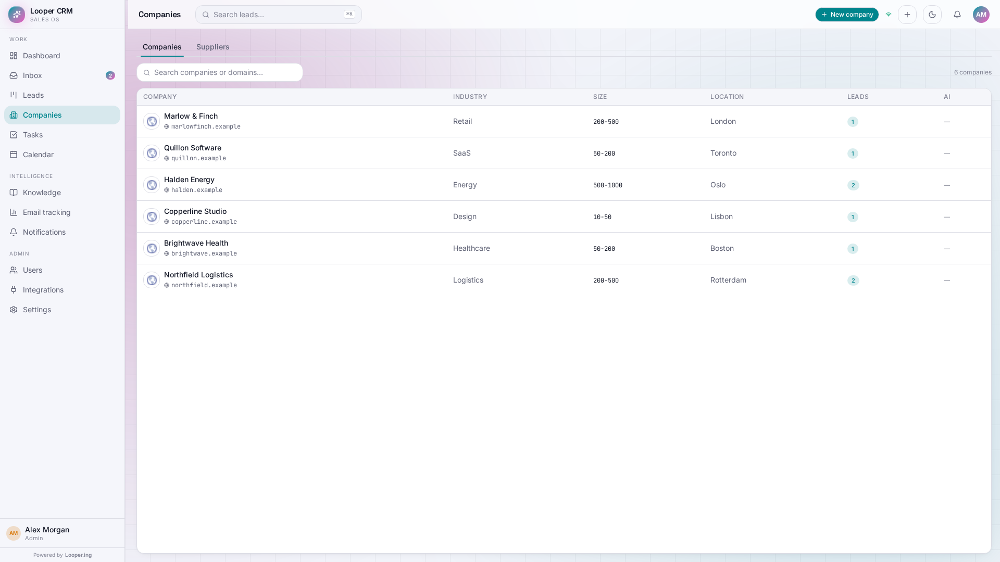
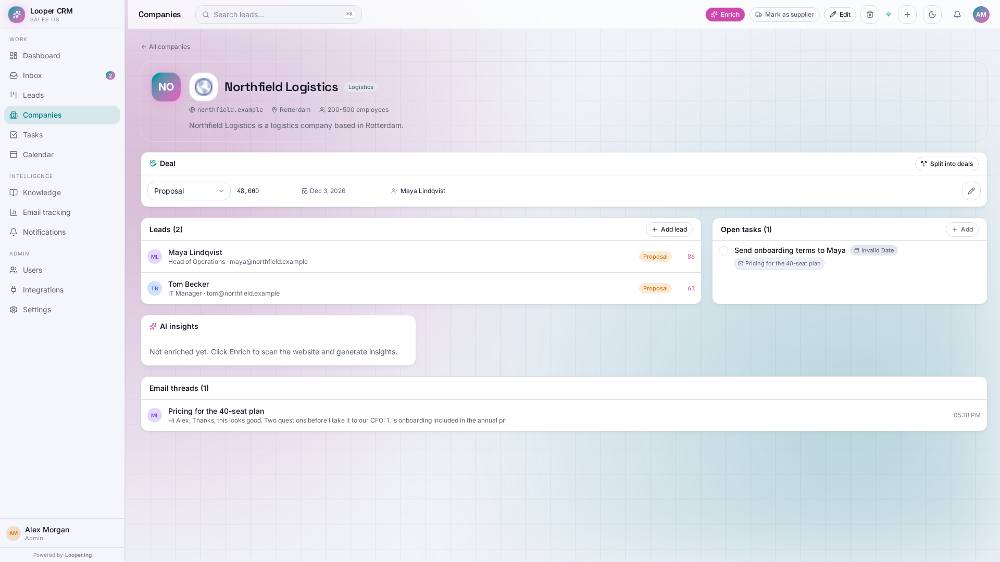
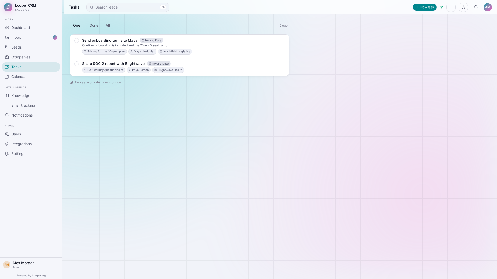

# Looper CRM

AI-assisted, local-first CRM: leads, companies & deals (one deal per company, splittable), Gmail inbox (HTML mail with inline images and attachments) with AI-suggested replies grounded in company knowledge (RAG), Google Calendar scheduling, and email open/click/bounce tracking. Realtime updates over Socket.IO. Dark & light themes.

## Why this exists
I wanted to see whether I could ramp up a working CRM within a few hours. Up to now it has taken less than 8 hours of my time — from an empty folder to what you see below: leads, companies and deals, a Gmail inbox with AI-suggested replies, calendar scheduling and email tracking.

## Screenshots
Taken from a local instance filled with fictional demo data.

| | |
|---|---|
| **Dashboard** — pipeline, mail awaiting a reply, hottest leads<br> | **Inbox** — threads, conversation, AI suggested reply<br> |
| **Leads** — Kanban by pipeline stage<br> | **Deals** — one row per deal with contact, amount and close date<br> |
| **Companies**<br> | **Suppliers** — the second tab of the Companies page<br> |
| **Company page** — deal, leads, tasks, AI insights, threads<br> | **Tasks**<br> |

## Layout
```
frontend/   React 19 + Vite + TypeScript + Tailwind v4 (+ socket.io-client)
backend/    Node 22 + Express + Socket.IO + SQLite (node-sqlite3-wasm) + googleapis + Anthropic SDK
docs/       prd.md, screenshots/
```

## Quick start
```bash
# backend
cd backend && cp .env.example .env && npm install && npm run dev      # http://localhost:3101
# frontend (proxies /api, /ws, /t to the backend)
cd frontend && npm install && npm run dev                              # http://localhost:5173
```
First run seeds an admin: `admin@looper.local` / `admin1234` (override with `SEED_ADMIN_EMAIL` / `SEED_ADMIN_PASSWORD`). Change it in Settings → Password.

## Setup checklist (admin)
1. **Admin → Integrations → Google Workspace OAuth**: create an OAuth web client in Google Cloud (enable Gmail API + Calendar API), paste client id/secret, use the shown redirect URI. Optional: a Pub/Sub topic for Gmail push (polling every 2 min otherwise).
2. **Admin → Integrations → AI providers**: Anthropic API key (drafts + enrichment). Optional Voyage AI key for embeddings; without it an offline hashing embedder is used.
3. **Knowledge**: upload PDFs/DOCX/MD/TXT or scan your website. Replies cite these chunks.
4. Each user: **Settings → Email & calendar → Connect Google account**, and set a scheduling link + working hours in Profile.

## Backend layering
`routers` (zod validation) → `controllers` (authN/authZ, payload) → `managers` (logic) → `repositories` (SQL) → `db/dbAccessor` (SQLite + migrations). `services/` do side-work (LLM, embeddings, Gmail/Calendar, MIME, crawler/parsers, crypto, sockets, scheduler). `constants.ts` is the only `process.env` reader. All failures return 4XX `{ code, message }`.

## Frontend layering
`http/httpClient` (auth header, refresh-on-401, HttpError) → `api/*` (ApiError) → pages/components. Browser APIs only via `services/` (storage, theme, socket, notifications, clipboard). Every element has a unique `data-cmp`.

## Public endpoints
`GET /t/o/:token.gif` open pixel · `GET /t/c/:token?u=` click redirect · `POST /api/webhooks/gmail` Pub/Sub push · `GET /api/google/callback` OAuth · `GET /api/emails/attachments/:id` (user-bound signed url).

## Security notes
- **Set your own secrets before exposing an instance**: `JWT_SECRET`, `JWT_REFRESH_SECRET`, `ENCRYPTION_KEY` (long random values) and `SEED_ADMIN_PASSWORD`. The backend logs a `SECURITY WARNING` at startup while any of them is still a default.
- Mail is private per user: threads, drafts and attachments are only reachable by the owner of the connected Gmail account. Leads, companies, deals and knowledge are shared across the workspace.
- Mail HTML is sanitized server-side (no scripts, handlers, forms, media, sender classes or remote images without consent). Attachments that can carry script (svg, html…) are always downloaded, never rendered.
- The click redirect only follows links that the tracked message actually contains (no open redirect). Login is rate-limited per IP and email.
- Server-side fetches of user-supplied urls (knowledge crawl, company enrichment) refuse private, loopback and link-local addresses.
- Google OAuth tokens, the OAuth client secret and AI provider keys are stored encrypted (AES-256-GCM, `ENCRYPTION_KEY`).
- Optional `GMAIL_WEBHOOK_TOKEN`: when set, the Pub/Sub push url must carry `?token=<value>`.

## Design
Mockups: `/design/index` · Design system: `/design/design-system` · Guide: `/design-guide`. Visual language "Cyber Bloom" (teal→pink brand gradient, indigo dark surfaces, grid-net backdrop, per-section glow, Space Grotesk headings).

## API additions (2026-10-17)
- `GET /api/emails/threads?before=<iso>&limit=<n>` — cursor pagination (default 40, max 100).
- `DELETE /api/emails/threads/:id` — remove a thread from the CRM (cascades messages, drafts, events).
- `POST /api/emails/threads/:id/convert` — create a lead from the thread's counterpart and link the thread.
